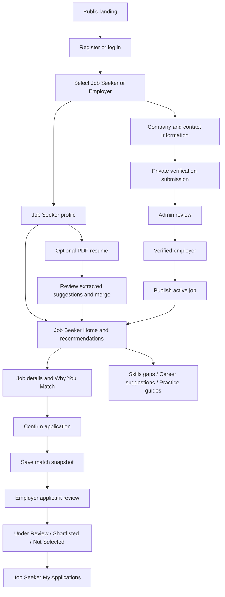
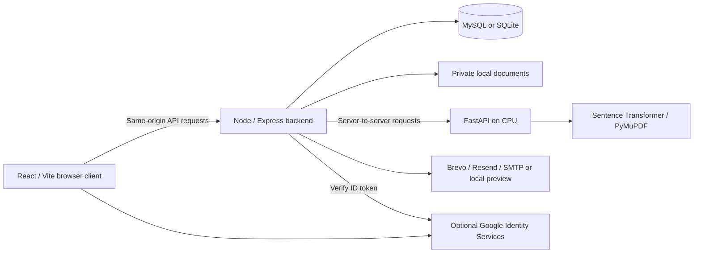

# MIMAROPA Works

**AI-Powered Employment and Career Development Platform for MIMAROPA**

MIMAROPA Works connects Job Seekers with verified regional employers through explainable semantic job matching. It combines a working recruitment loop with skills-gap analysis, occupation exploration, and guided practice for career development.

Built for **MinSU InnoHack 2026**, under the team-provided theme: **Harnessing Artificial Intelligence and Entrepreneurship to Address Unemployment**.

This documentation describes the source inspected on **13 September 2026**. It does not claim measured employment outcomes, government endorsement, or a model trained from scratch.

[Documentation index](docs/README.md) · [Technical architecture](docs/ARCHITECTURE.md) · [API reference](docs/API.md) · [InnoHack narrative](docs/INNOHACK_DOCUMENTATION.md) · [Demo script](docs/DEMO_SCRIPT.md)

## Implementation status

| Status                                   | Scope                                                                                                                                                                                                                                                                                                                                            |
| ---------------------------------------- | ------------------------------------------------------------------------------------------------------------------------------------------------------------------------------------------------------------------------------------------------------------------------------------------------------------------------------------------------ |
| Implemented — Core Recruitment MVP v1    | Authentication, role selection, profile onboarding, optional resume parsing/review/merge, employer verification, Admin review, draft/publish/close jobs, semantic recommendations, full job details, applications, employer applicant review, stored match snapshots, Under Review/Shortlist/Not Selected, withdrawal and status synchronization |
| Implemented — Career Development Phase 1 | `/jobs` Home and real active-vacancy search, skills gaps, 10 occupation suggestions, 10 internal self-guided training/practice guides                                                                                                                                                                                                            |
| In development / hardening               | No additional major product workflow is claimed as implemented. Production hardening and the limitations below remain engineering work.                                                                                                                                                                                                          |
| Planned                                  | Workplace readiness, interview practice, distance-based discovery, labor analytics and later workflows listed in the roadmap                                                                                                                                                                                                                     |

## Problem statement

Job seekers can struggle to connect their skills and experience with suitable vacancies. Opportunities across MIMAROPA's geographically dispersed provinces can be difficult to discover, while employers need clearer evidence of applicant-job compatibility. Unverified employers add trust concerns. A list of jobs alone does not explain which skills a seeker could develop next.

The prototype addresses these problems through regional location fields, verified-employer publishing, explainable matching, and actionable skill gaps. It does not present unsupported unemployment statistics or claim to solve unemployment on its own.

## Proposed solution and target users

A conventional job board mainly supports manual vacancy search. MIMAROPA Works adds a reviewed skills profile, local semantic comparison, structured match explanations, and career-development guidance.

| Role          | Responsibility                                                                                                                                                                                                |
| ------------- | ------------------------------------------------------------------------------------------------------------------------------------------------------------------------------------------------------------- |
| Job Seeker    | Build and review a profile, explore jobs/careers, apply, track or withdraw applications, and explore practice guides                                                                                          |
| Employer      | Submit company verification, maintain job drafts, publish once verified, review actual applicants and deliberately update status                                                                              |
| Administrator | Review employer information and private documents; approve or reject verification. This can support a PESO-style administrative role, but there is no deployed PESO integration or labor-analytics dashboard. |

## Current end-to-end flow



Interview scheduling, offers and hiring are outside the implemented workflow.

## Key implemented features

### Authentication and roles

- Email/password registration and login, Argon2id password hashing, server-side sessions, logout, password recovery, and email verification links.
- Resend verification queues a replacement link. “I've verified my email” refreshes account state; it does not itself verify an address.
- Public role selection permits Job Seeker or Employer; Admin accounts use an operator-only creation script and `/admin/login`.
- Google Identity Services login is implemented with server-side ID-token verification and account-linking safeguards. It requires a valid Web client ID and authorized origin; live Google-provider configuration is deployment-specific. It is not merely a client-decoded identity, nor is live Google sign-in claimed by the unit tests.

### Job Seeker and career development

- Three basic profile steps collect location, education/skills and work preferences; optional Resume is the next step and remains accessible later.
- Private PDF upload (5 MiB), PyMuPDF extraction, dictionary/alias/rule detection and review before merge. Existing education remains the default unless resume information is selected.
- Real recommendations, full job details, explanation, application confirmation, My Applications, withdrawal and readable status labels.
- Home searches actual evaluated active, unexpired vacancies by title, company, skills, location, industry and work setup. No sample landing-page data is used by the authenticated Home API.
- Gaps distinguish required/preferred skills and aggregate affected jobs. Priority uses frequency, requirement type and match strength, not labor-market statistics.
- Occupation suggestions are separate from vacancies. Training is a controlled set of **internal self-guided practice guides**, not accredited courses, certifications, TESDA programs or externally validated training.

### Employer and Administrator

- Four-step company/contact/document/review onboarding and visible Pending/Verified/Rejected/Suspended presentation states. The current review APIs approve/reject; there is no suspension action.
- Private PDF/PNG/JPEG verification uploads (up to three files, 8 MiB each), Admin queue/detail/document access, approval or rejection with a reason.
- Owned job drafts, verified-employer publishing and closing; dashboard and actual applicant counts. Job editing is not implemented as an API.
- Actual applicants only, newest/oldest/stored-match sorting, job filtering, job-specific applicant views, details and protected resume downloads.
- Deliberate Under Review, Shortlist and Reject actions. Rejected is displayed as **Not Selected**. Withdrawn applicants remain historical and cannot be actioned. Closing a job preserves its applications.

## Frontend routes

| Audience               | Routes                                                                                                                                                                                                                                       |
| ---------------------- | -------------------------------------------------------------------------------------------------------------------------------------------------------------------------------------------------------------------------------------------- |
| Public/authentication  | `/`, `/login`, `/register`, `/verify-email`, `/reset-password`, `/admin/login`                                                                                                                                                               |
| Job Seeker onboarding  | `/onboarding/select-role`, `/onboarding/job-seeker`, `/onboarding/job-seeker/resume`                                                                                                                                                         |
| Job Seeker recruitment | `/dashboard` (Home), `/jobs`, `/profile`, `/people`, `/jobs/recommended`, `/jobs/:id`, `/applications`, `/profile/resume`                                                                                                                                       |
| Career development     | `/career`, `/career/readiness`, `/career/resume-optimizer`, `/career/interview`, `/career/coach`, `/career/skills-gap`, `/career/suggestions`, `/career/training`, `/career/training/:id`                                                                                                                                           |
| Employer               | `/onboarding/employer`, `/employer/verification-status`, `/employer/dashboard`, `/employer/jobs`, `/employer/jobs/new`, `/employer/jobs/:id`, `/employer/applicants`, `/employer/jobs/:id/applicants`, `/employer/applicants/:applicationId` |
| Admin                  | `/admin`, `/admin/verifications`, `/admin/jobs`, `/admin/accounts`, `/admin/audit-logs`                                                                                                                                                                                                                       |

Signed-out `/` stays public. Completed Job Seekers go to `/jobs`; verified Employers go to `/employer/dashboard`; Admins go to `/admin`. Incomplete accounts continue onboarding; pending Employer login goes to verification status. The existing `/jobs/recommended` remains available through the Jobs navigation item.

## AI / Machine Learning

The separate local FastAPI service loads the **pretrained** `sentence-transformers/paraphrase-multilingual-MiniLM-L12-v2` once at startup on **CPU**. The verified runtime is Python **3.10.11**, with **384-dimensional embeddings**. Multilingual MiniLM was selected because profile and job text may contain English, Filipino or Taglish; this is a design choice, not a measured guarantee of equal accuracy across languages.

Core matching does not require OpenAI, Gemini, Claude or another paid generative-AI API. First model loading may download model weights; subsequent operation can use the local cache.

### Semantic and weighted matching

Normalized profile text and normalized job text are encoded with `normalize_embeddings=True`. Their dot product is cosine similarity. The AI endpoint clamps this to 0–1 and returns `engine: sentence_transformer`.

| Component           | Weight | Current rule                                                                                                                |
| ------------------- | -----: | --------------------------------------------------------------------------------------------------------------------------- |
| Semantic similarity |    45% | Local embedding cosine similarity; legacy text overlap if AI fails                                                          |
| Skills              |    25% | Fraction of required skills matched case-insensitively; 1 if none required                                                  |
| Location            |    15% | Remote or same municipality: 1; same province: 0.8; otherwise: 0.4                                                          |
| Education           |    10% | Ordered attainment levels. Recommendation scoring grants 0.5 one level below; application scoring uses meets/does-not-meet. |
| Experience          |     5% | Meets minimum: 1; otherwise recorded years/minimum. Basic onboarding currently records zero years.                          |

```text
final_score = clamp(semantic × 0.45 + skills × 0.25 + location × 0.15
                    + education × 0.10 + experience × 0.05, 0, 1)
match_percentage = round(final_score × 100)
```

Higher scores rank first. Scores support human decisions; they are not hiring probabilities. At application time, component values, overall percentage, matched skills and missing skills are stored. They are not silently recalculated when profiles change. Current profile details and the latest available resume are not immutable snapshots; see [Database](docs/DATABASE.md).

The verified phrase comparison produced **0.6095 related** versus **0.1904 unrelated** for customer-support/social-media text against related service work and unrelated backend engineering. This demonstrates behavior beyond literal keyword overlap, not a full accuracy benchmark. Reproduce with `ai-service/semantic_test.py`.

Demo fixture results include **86% Marketing Assistant job match**, and occupation similarities **80% Marketing Assistant / 66% Social Media Associate**. These are observed fixture results, never hardcoded promises for another profile. The separate MySQL fixture can produce a different percentage.

### Fallback and career comparison

The Node backend calls FastAPI with a 2.5-second semantic timeout. Unavailability, timeout or invalid responses retain **`text_overlap_fallback`** for vacancies. The final weighted score remains bounded, allowing a demo to continue. The legacy overlap component itself can exceed 1 for repeated words; it is not an embedding score.

Career suggestions compare the same normalized profile with ten controlled occupation texts, rank clamped semantic similarity, and explain relevant/missing catalog skills. They do **not** use the vacancy five-component formula. Career AI failure is explicitly labelled **`skills_overlap_fallback`** and uses matching catalog skills/total catalog skills. Neither development scores nor training suggestions are sent to employers as hiring criteria.

### Resume processing is separate


Sentence Transformers do **not** extract structured education, names or experience. The parser uses limited heuristics and no OCR. Image-only or unreadable files receive a clear failure/text-unavailable result. Raw extracted text is not returned by the analyzer; suggestions are retained separately from accepted profile fields. See the merge limitations in [Architecture](docs/ARCHITECTURE.md).

## System Architecture

This is a **client-server web application with REST APIs and a separate AI inference service**, not a large microservices deployment.



The browser does not navigate through port 8000. Vite proxies `/api` to the Node backend. FastAPI owns inference/extraction; Node owns authentication, authorization, business rules, persistence and private-file access. [Architecture diagrams and flows](docs/ARCHITECTURE.md).

## Technology stack and core dependencies

Versions below are **resolved package-lock versions**, not merely manifest ranges. Python versions are observed in the verified runtime; `ai-service/requirements.txt` is currently unpinned.

| Layer            | Core packages / observed version                                                | Purpose                                                                                     |
| ---------------- | ------------------------------------------------------------------------------- | ------------------------------------------------------------------------------------------- |
| Runtime          | Node.js 24.14.0; npm 11.19.1                                                    | Express runtime, native SQLite and Node test runner                                         |
| UI               | React / react-dom 19.3.0; TypeScript 5.9.3                                      | Typed components and forms                                                                  |
| Build/style      | Vite 7.3.6; @vitejs/plugin-react 5.2.0; Tailwind CSS / @tailwindcss/vite 4.3.3  | Development server, build and styling                                                       |
| Visuals          | lucide-react 0.468.0; @fontsource-variable/inter 5.3.0                          | Icons and locally bundled font                                                              |
| API              | Express 5.2.1; dotenv 17.4.2                                                    | Routes and environment loading                                                              |
| Authentication   | argon2 0.45.1; google-auth-library 11.0.2; @react-oauth/google 0.13.5           | Password hashing and Google ID tokens                                                       |
| HTTP protection  | helmet 8.3.0; express-rate-limit 8.7.0                                          | Security headers and request limits                                                         |
| Uploads/database | multer 2.3.0; mysql2 3.24.4; observed MySQL 8.4.3 / SQLite 3.51.2 (node:sqlite) | Multipart uploads and persistence adapters                                                  |
| Email            | @getbrevo/brevo 6.0.3; resend 6.28.0; nodemailer 10.0.9                         | Provider adapters behind one service                                                        |
| Development      | concurrently 10.0.5; ESLint 9.39.5; typescript-eslint 8.70.0; Prettier 3.9.6    | Concurrent services, lint and formatting                                                    |
| Local browser QA | Playwright 1.63.0; @axe-core/playwright / axe-core 4.13.0                       | Desktop/mobile browser and accessibility checks; local `.qa` tooling, outside root manifest |

### Python AI dependencies

| Package               | Observed version | Purpose                                                                           |
| --------------------- | ---------------- | --------------------------------------------------------------------------------- |
| fastapi               | 0.141.1          | AI HTTP API and automatic documentation                                           |
| uvicorn               | 0.52.4           | ASGI server                                                                       |
| sentence-transformers | 6.0.1            | Pretrained text embeddings                                                        |
| torch                 | 2.14.0+cpu       | CPU tensor/model runtime                                                          |
| pymupdf               | 1.28.2           | PDF text extraction                                                               |
| python-multipart      | 0.0.32           | Multipart parsing in FastAPI                                                      |
| pydantic              | 2.13.5           | Request validation used by FastAPI/main.py; not separately listed in requirements |

These observations are not a Python lockfile. Preserve a working environment for demos; fresh installs may resolve different versions. No CUDA is required. MySQL/SQLite is the implemented database choice; there is no Supabase, Next.js or PostgreSQL integration.

## Local development / installation

Run commands from the repository root. Use Node.js 24 and Python 3.10.x. MySQL is the configuration default; SQLite needs no database server. Do not move the whole application to the Python environment directory.

### 1. Install and configure the application

PowerShell:

```powershell
npm install
if (-not (Test-Path .env)) { Copy-Item .env.example .env }
```

For lockfile-based CI/reproduction, use `npm ci` instead of `npm install`. Edit `.env` locally; never overwrite existing credentials. Clear the illustrative Brevo key/sender if using preview mode.

MySQL default: start the database service, set `DB_CONNECTION=mysql` and the appropriate `DB_*` values. Then:

```powershell
npm run db:create
npm run db:migrate
npm run db:status
```

`db:create` creates a missing database and requires suitable MySQL permissions. If already provisioned, start at migration. Commands preserve existing data. Expected status ends with **`007_applications - applied`**. Migration definitions are in `server/database.mjs`, not a `server/migrations/` directory.

SQLite alternative: disable the MySQL block and use only:

```dotenv
DB_CONNECTION=sqlite
DB_DATABASE=server/data/innohack.sqlite
```

Then run the same database commands. SQLite does not use host, port, username or password. Switching engines does not transfer existing records.

### 2. Prepare the AI runtime only if needed

**Skip environment creation/reinstallation if you already have the verified CPU runtime.** Activate it or use its Python executable explicitly.

New Windows environment:

```powershell
py -3.10 -m venv .venv
.\.venv\Scripts\python.exe -m pip install --upgrade pip
.\.venv\Scripts\python.exe -m pip install torch --index-url https://download.pytorch.org/whl/cpu
.\.venv\Scripts\python.exe -m pip install -r ai-service/requirements.txt
.\.venv\Scripts\Activate.ps1
```

On macOS/Linux: `python3.10 -m venv .venv`, then `source .venv/bin/activate` and use `python -m pip`. The CPU wheel index command is intended for supported Windows/Linux platforms; macOS can use its supported standard PyTorch wheel with CPU inference. Model loading needs weights available in the local cache or an initial network download.

### 3. Start services

Startup order: database (when MySQL) → AI service → main app. In an activated Python environment:

```powershell
python -m uvicorn main:app --app-dir ai-service --host 127.0.0.1 --port 8000
```

In a second terminal at the project root:

```powershell
npm run dev
```

| Service         | Default URL           | Source                               |
| --------------- | --------------------- | ------------------------------------ |
| Frontend        | http://127.0.0.1:5173 | `vite.config.ts`                     |
| Application API | http://127.0.0.1:3001 | `server/index.mjs`; `API_PORT`       |
| Local AI        | http://127.0.0.1:8000 | Startup command and `AI_SERVICE_URL` |

Use `127.0.0.1` consistently with `APP_ORIGIN`. Changing `API_PORT` also requires aligning Vite's proxy target. FastAPI `/health` should report `ok`, the MiniLM model name and dimension 384. `/docs` and `/redoc` are enabled for local API exploration.

```powershell
Invoke-RestMethod http://127.0.0.1:8000/health
python ai-service/semantic_test.py
```

Production-style serving uses `npm run build` followed by `npm start` with `NODE_ENV=production`, HTTPS `APP_ORIGIN`, configured email delivery and an HTTPS reverse proxy. The server binds loopback. This is a deployment starting point, not a completed production operations guide.

### 4. Administrator account

Use a new address and a 12–128 character password through temporary shell variables; never commit them. For example, set `ADMIN_EMAIL`, `ADMIN_NAME`, and `ADMIN_PASSWORD` in your local terminal, then:

```powershell
npm run admin:create
Remove-Item Env:ADMIN_PASSWORD
```

The command refuses to modify an existing account. Log in through `/admin/login`. There is no public Admin registration.

### Promote an existing local account to Admin

For local development, promote a registered active account without changing its password or authentication provider:

```powershell
npm run admin:promote -- user@example.com
```

The command is disabled when `NODE_ENV=production`. It finds the exact normalized email in the configured database and changes only `users.role` to `admin` plus `updated_at`. It does not create an API endpoint, change `password_hash`, email verification, sessions, Google linkage, profile data, `role_selected`, or `account_status`. It fails if the account is absent/inactive and is safe to repeat for an existing Admin. Sign in using `/admin/login`, then open `/admin` (the verification queue is at `/admin/verifications`).

**Mabilis na local check:** simulan ang MySQL kung iyon ang napili, i-check ang `db:status`, buksan ang AI terminal, saka `npm run dev`. Kung walang email provider, gamitin ang private mail preview. Huwag ilagay ang totoong keys sa README o frontend.

## Environment configuration

[.env.example](.env.example) is the sanitized reference. Names/purposes:

| Variables                                                                      | Purpose                                                           |
| ------------------------------------------------------------------------------ | ----------------------------------------------------------------- |
| `APP_ORIGIN`, `API_PORT`                                                       | Exact browser origin and Node listening port                      |
| `AI_SERVICE_URL`                                                               | Backend-only FastAPI base URL; blank allows vacancy fallback      |
| `DB_CONNECTION`, `DB_DATABASE`                                                 | MySQL or SQLite; database name or SQLite file                     |
| `DB_HOST`, `DB_PORT`, `DB_USERNAME`, `DB_PASSWORD`                             | MySQL connection values                                           |
| `DATABASE_PATH`                                                                | Legacy SQLite filename fallback when `DB_DATABASE` is absent      |
| `GOOGLE_CLIENT_ID`, `VITE_GOOGLE_CLIENT_ID`                                    | Matching Google Web client IDs; ID is public, not a client secret |
| `BREVO_API_KEY`, `BREVO_SENDER_EMAIL`, `BREVO_SENDER_NAME`                     | Primary transactional provider and verified sender                |
| `RESEND_API_KEY`, `MAIL_FROM`                                                  | Legacy Resend configuration/sender                                |
| `SMTP_HOST`, `SMTP_PORT`, `SMTP_SECURE`, `SMTP_USER`, `SMTP_PASS`, `MAIL_FROM` | SMTP alternative                                                  |
| `NODE_ENV`                                                                     | Enables production cookie/startup/static-serving behavior         |
| `ADMIN_EMAIL`, `ADMIN_PASSWORD`, `ADMIN_NAME`                                  | Operator-only account creation inputs; temporary shell variables  |
| `LIVE_AI_TEST`, `TEST_DB_CONNECTION`                                           | Test controls; see testing guide                                  |

Only the Google public client ID belongs in a `VITE_*` variable. Provider keys, passwords and tokens remain backend-only. No separate JWT/session secret is required by the current opaque-session implementation.

## Email architecture

The Node mail queue feeds `server/services/emailService.mjs`. Provider selection at startup is:

1. Brevo when key **and sender email** exist.
2. Otherwise Resend when its key exists (configure `MAIL_FROM`).
3. Otherwise configured SMTP.
4. Otherwise local `server/data/mail-preview` text files.

This is **configuration precedence, not automatic runtime failover**. A provider exception does not switch to another provider or preview. The worker runs every five seconds, processes up to five queued messages, retries failures up to five attempts and removes queue rows older than 24 hours. Preview means no inbox delivery.

`POST /api/auth/resend-verification` requires authentication, CSRF and recovery rate limits. It replaces the previous verification token and queues a link valid for 24 hours. Password-reset links last 30 minutes. Current verification is link-based, not a six-digit OTP flow. Employer submission/approval/rejection emails also reuse the service. Provider acceptance is not proof of inbox delivery; see [known email limitations](docs/SECURITY.md).

## Database and private storage

[Database reference and ER diagram](docs/DATABASE.md) document users, sessions, profiles, documents, jobs, resumes, applications and all seven migrations. MySQL and SQLite share the application model through adapters.

- `server/data/resumes`: private resumes.
- `server/data/verification-documents`: private employer submissions.
- `server/data/mail-preview`: development messages that may contain addresses and one-use links.

These directories are not static web roots. Employer resume download requires an actual application to an employer-owned job. The current response is a protected download, not an embedded PDF viewer or public URL. Local filesystem storage is an MVP choice; production object storage, retention and backups remain future operational work.

## Testing and quality assurance

Latest verified baseline: **22/22 automated tests**, **14/14 MySQL + live-AI API tests**, build/lint passed, desktop/mobile browser and Axe checks passed, and existing applicant-review regression passed. These are scenario results, not a claim of 100% coverage.

```powershell
npm test
npm run build
npm run lint
$env:LIVE_AI_TEST='1'
npm run test:mysql
Remove-Item Env:LIVE_AI_TEST
```

The MySQL test user needs temporary-database creation/drop privileges. Tests use isolated fixtures. Details, exact evidence scope, browser tooling availability and known coverage gaps: [Testing](docs/TESTING.md).

## Project structure

```text
InnoHack/
├── src/
│   ├── App.tsx
│   ├── auth/
│   ├── components/       # Seeker, employer, applicant and landing UI
│   ├── data/             # Public illustrative landing data
│   └── types/
├── server/
│   ├── app.mjs
│   ├── database.mjs      # Adapters AND migrations 001–007
│   ├── schema-sqlite.mjs
│   ├── schema-mysql.mjs
│   ├── career.mjs        # Occupation/practice catalogs
│   ├── services/
│   ├── emails/
│   ├── index.mjs
│   ├── db-cli.mjs
│   └── *.test.mjs
├── ai-service/
│   ├── main.py
│   ├── requirements.txt
│   └── semantic_test.py
├── docs/
├── .env.example
├── package.json
├── package-lock.json
└── README.md
```

Private files, dependencies, model caches and local `.qa` artifacts are omitted. The checkout currently has no `.git` metadata; this documentation is GitHub-ready but does not claim that a repository has been published.

## Limitations

- Local CPU inference and private filesystem storage; no vector database, embedding persistence, cloud storage or geospatial distance calculation.
- Rules-based parsing can miss or misclassify education/course/experience; no OCR. Resume metadata and applicant profile fields are not fully immutable historical snapshots.
- Re-completing basic onboarding rebuilds normalized profile data with basic defaults. Resume merge uses one `use_resume` switch for non-skill suggestions; it is not field-by-field conflict resolution.
- Recommendation and application scoring share weights but have some differing component/text rules. See [Architecture](docs/ARCHITECTURE.md).
- `/jobs` filters expired vacancies; the legacy `/jobs/recommended` query filters active status only. Job details and Apply enforce deadline checks.
- Employer verification MIME/size checks are not malware scanning or proof of document authenticity. Changes to an already verified company's profile do not automatically trigger re-verification.
- Ten occupations and ten practice guides are limited catalogs, not validated assessments. No labor analytics or measured impact outcomes exist.
- No application status-history table, notification center, interview scheduling, offers or hired workflow. No full production security/compliance audit has been performed.

## Roadmap

**Already delivered:** Job Seeker Home/job discovery, skills-gap analysis, occupation recommendations and personalized upskilling guides. These are not future items.

**Next planned:** Workplace Readiness Assessment; AI Interview Practice; nearby/distance-based job discovery; Admin/PESO Labor Analytics.

**Later / Phase 2:** AI Resume Optimization; AI Career Coach; Job/Industry Simulation; Employer AI Initial Screening; Human Career Coaching; interview scheduling; offer/hired workflow. These are plans, not working integrations or automatic hiring decisions.

## Social impact and sustainability

The project aims to improve local opportunity discovery, explain job-skill compatibility, reduce unverified-publisher risk, and connect missing skills to practical next steps. This direction aligns with **SDG 8 — Decent Work and Economic Growth**. Regional workforce insight is a planned extension, not an implemented analytics capability.

Possible sustainability paths include institutional/PESO partnerships and employer service support, subject to stakeholder validation. No revenue, partnership, placement-rate or unemployment-reduction claims are made. The [InnoHack team document](docs/INNOHACK_DOCUMENTATION.md) separates these hypotheses from the working prototype.


See [Career, profile, employer accounts, and Admin update](docs/CAREER_ADMIN_UPDATE.md) for the implemented tools, Associate Degree support, profile-save repair, audit logs, and [300 local demo employer accounts](docs/DEMO_EMPLOYERS.md).
# MIMAROPAWORKS

