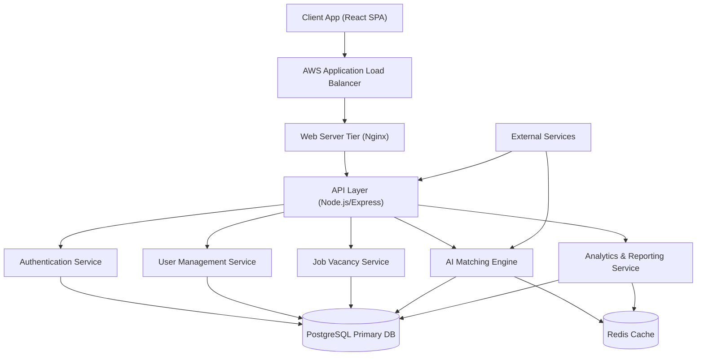
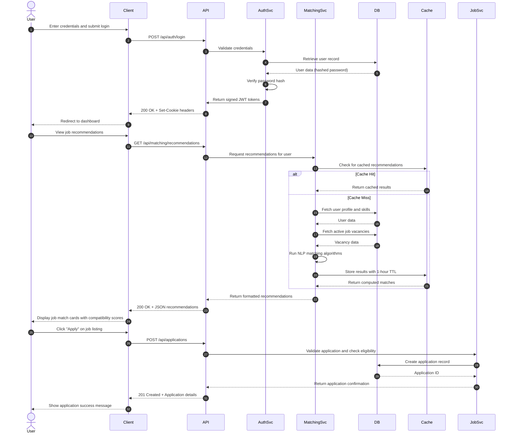

# ARCHITECTURE — System Architecture

> **Purpose:** Describe the high-level architecture, module boundaries, data flows, client/server structure, and cross-cutting concerns so developer decisions align with system integrity. Tier-3 template — fill it in for your project.

_Last updated: September 12, 2026_

---

## 1. System Overview & High-Level Architecture

MIMAWorks AI employs a modern full-stack architecture optimized for AI-powered job matching. The system consists of a React-based frontend, Node.js/Express backend, and PostgreSQL database with Redis caching. Key services include the AI matching engine, user management, job vacancy management, and analytics dashboard. Communication occurs via RESTful APIs over HTTPS, with WebSocket connections for real-time updates.

- **Dev Server Topology:** Vite 6.dev server with React Fast Refresh for rapid development iteration
- **Production Pipeline:** Dockerized deployment with multi-stage builds, served via Nginx reverse proxy
- **Deployment Target:** AWS EC2 instances with Application Load Balancer for horizontal scaling

### Architecture Diagram



---

## 2. Layered Architecture & Conventions

The system follows a Clean Architecture approach with clear separation of concerns between presentation, application, and infrastructure layers.

- **Presentation / View Layer:** React 18 components with hooks, organized by feature domains (job seeker dashboard, employer portal, admin console)
- **Application / Domain Layer:** Use cases and business logic encapsulated in service classes, including matching algorithms, validation rules, and workflow orchestration
- **Infrastructure / Data Access Layer:** Repository pattern with Prisma ORM for database access, external API adapters for third-party services, and caching layer implementations

---

## 3. Directory & Domain Structure

```
src/
├── components/          # Shared reusable UI primitives (buttons, forms, modals)
├── features/            # Feature modules grouped by user role
│   ├── job-seeker/      # Job seeker dashboard and profile management
│   ├── employer/        # Employer dashboard and job posting
│   ├── admin/           # Administrative controls and analytics
│   └── matching/        # AI matching algorithms and recommendation logic
├── lib/                 # Third-party configuration & SDK wrappers (AWS, NLP libraries)
├── services/            # API and data fetching clients (REST clients, WebSocket managers)
├── hooks/               # Custom React hooks for data fetching and state management
├── utils/               # Utility functions and helpers
├── contexts/            # React context providers (auth, theme, loading states)
└── types/               # Shared domain TypeScript interfaces and types
```

- **Module Boundary Rules:** Features must communicate through well-defined service interfaces. Direct state manipulation between features is prohibited. Shared components must be generic and reusable across features.

---

## 4. Middleware & Request Pipeline

The Express backend implements a structured middleware pipeline for security, validation, and request processing.

- **Step 1:** Security Middleware (Helmet, CORS, Rate Limiting)
- **Step 2:** Body Parsing Middleware (JSON, URL-encoded, multipart/form-data)
- **Step 3:** Authentication Middleware (JWT verification)
- **Step 4:** Request Validation Middleware (Zod schema validation)
- **Step 5:** Logging Middleware (Request/response logging with correlation IDs)
- **Step 6:** Route Handler / Controller Execution
- **Step 7:** Error Handling Middleware (Centralized error formatting)
- **Step 8:** Response Compression Middleware (Gzip/Deflate)

---

## 5. Client-Side Architecture

The frontend uses React with modern state management and routing patterns for optimal user experience.

- **View Layer:** React 18 functional components with Tailwind CSS for styling
- **State Management:** 
  - Server State: React Query for data fetching and caching
  - Client State: Zustand for global UI state (user preferences, theme)
  - Form State: React Hook Form with Zod validation
- **Routing Strategy:** React Router v6 for client-side routing with lazy loading
- **Code Splitting:** Route-based and component-based lazy loading for performance

---

## 6. Data Layer & Database Strategy

Data persistence is handled through a relational database with strategic caching for performance optimization.

- **ORM / Query Builder:** Prisma ORM with PostgreSQL provider for type-safe database access
- **Caching Layer:** Redis for:
  - Session storage and authentication tokens
  - Frequently accessed job listings and user profiles
  - Computed matching scores with TTL-based invalidation
- **Connection Management:** Prisma connection pooling with AWS RDS Proxy for efficient connection handling
- **Backup Strategy:** Automated daily snapshots with point-in-time recovery
- **Data Migration:** Prisma Migrate for schema version control and deployment

---

## 7. Authentication & Authorization Flow

Secure authentication and role-based access control protect user data and system integrity.

- **Auth Provider:** Custom JWT-based authentication with refresh token rotation
- **Session Model:** HTTP-only secure cookies for access tokens, refresh tokens in database with rotation
- **Authorization Model:** Role-Based Access Control (RBAC) with three primary roles:
  - Job Seeker: Access to profile, job search, and application features
  - Employer: Access to job posting, applicant management, and company profile
  - Administrator: Access to user management, system settings, and analytics
- **Password Security:** bcrypt hashing with salt, minimum 12-character requirements
- **Multi-Factor Authentication:** Optional TOTP-based MFA for enhanced security

---

## 8. Key Data Flows & Sequence Diagrams

Primary user interactions follow predictable data flows through the system architecture.



---

## 9. Domain Logic Highlights

The AI matching engine incorporates several domain-specific algorithms and business rules.

- **Semantic Matching Algorithm:** 
  - Uses TF-IDF vectorization and cosine similarity for skill-to-job matching
  - Incorporates location proximity weighting (within 50km radius preferred)
  - Applies experience level matching (entry, mid, senior) with tolerance ranges
  - Considers industry/domain alignment with hierarchical taxonomy matching
  - Generates explainability scores showing which factors contributed most to match quality

- **Skills Gap Analysis:**
  - Compares user skills against job requirements
  - Identifies missing critical skills with frequency weighting
  - Suggests complementary skills that increase match probability by 20%+
  - Provides learning resource recommendations based on regional availability

- **Employer Ranking Algorithm:**
  - Scores applicants based on match percentage, application completeness, and response time
  - Applies diversity and inclusion weighting when configured
  - Considers historical hiring success rates for similar profiles
  - Generates explainability reports showing ranking factors

- **Labor Market Insights Calculation:**
  - Aggregates anonymized data on skill demand vs. supply
  - Identifies emerging skill trends in the regional market
  - Calculates salary benchmarks by role, experience, and location
  - Measures employment duration and retention correlations

---

## 10. Cross-Cutting Concerns

Standardized approaches ensure consistency, security, and performance across the system.

- **Error Handling:** 
  - Standardized error payloads with `errorCode`, `message`, and optional `details`
  - HTTP status codes aligned with REST conventions (4xx for client errors, 5xx for server)
  - Global error boundaries in React to prevent cascading UI failures
  - Structured logging with correlation IDs for request tracing

- **Input Validation:** 
  - Zero-trust validation at all trust boundaries (API endpoints, form submissions)
  - Zod schemas for runtime type safety and validation
  - Sanitization of user-generated content to prevent XSS attacks
  - File upload validation for type, size, and content

- **Security:** 
  - OWASP Top 10 compliance with regular dependency scanning
  - Content Security Policy (CSP) with nonce-based script allowance
  - Parameterized queries to prevent SQL injection
  - Secure headers (HSTS, X-Frame-Options, X-Content-Type-Options)
  - Regular penetration testing and security audits
  - Environment variable validation and secret management via AWS Secrets Manager

- **Observability & Logging:** 
  - Structured JSON logging with Winston logger
  - Distributed tracing with OpenTelemetry for cross-service requests
  - Error tracking with Sentry for frontend and backend exceptions
  - Performance monitoring with custom metrics (API latency, DB query times)
  - Business metrics tracking (match rates, application conversions, user engagement)

- **Performance Budgets:** 
  - Bundle size limits: < 200KB gzipped for initial JavaScript payload
  - First Contentful Paint: < 1.5s on 3G networks
  - Time to Interactive: < 3.5s on target devices
  - API response times: < 300ms for 95% of requests
  - Database query optimization with indexing strategies and query planning
