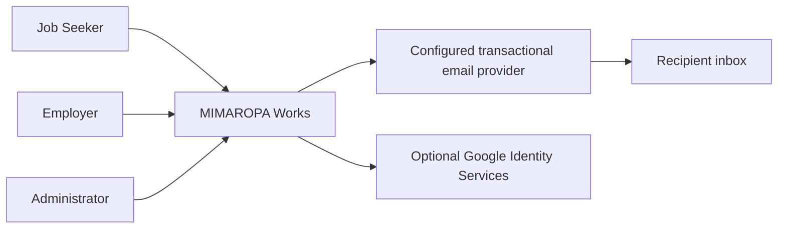
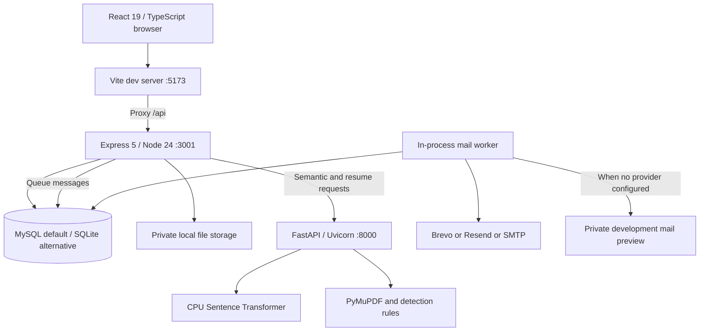
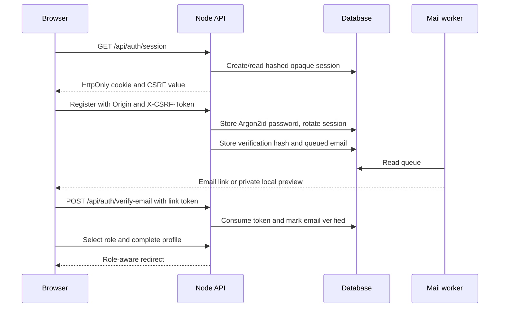
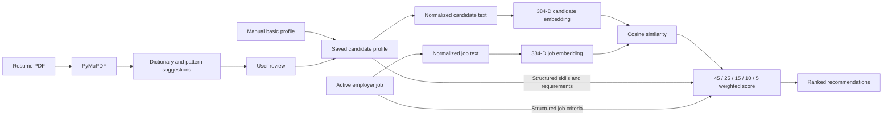
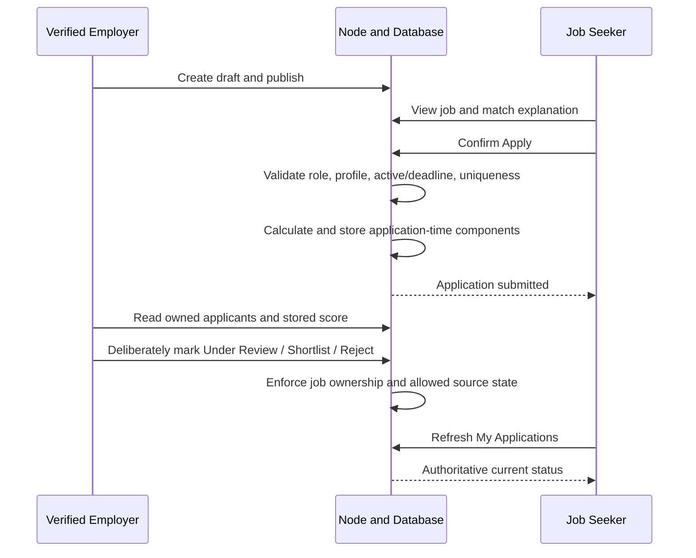

# System architecture

[Documentation index](README.md) · [API](API.md) · [Database](DATABASE.md)

## Architectural overview and boundaries

MIMAROPA Works is a client-server web system with a separate local AI service. React renders the UI; Express owns identity, authorization, persistence and recruitment; FastAPI performs CPU embeddings and PDF extraction. The design does not require a microservice cluster, cloud object store, vector database or paid LLM.

### C4-inspired system context

Brevo, Resend and SMTP adapters exist; provider credentials and successful inbox delivery depend on the deployment. Google ID-token verification is implemented, but a configured Web client and authorized browser origin are prerequisites. A PESO-style administrator is a role/use context, not an external integration.

### C4-inspired container view

In production mode Express serves `dist/` and an SPA fallback. Local development uses Vite proxying; browser route `/jobs/recommended` is never an AI-service route. Vite's proxy is currently fixed to Node port 3001. The Python environment can be external to this checkout without moving the application.

## Responsibilities and source map

| Boundary       | Source                                                                   | Responsibility                                                                                      |
| -------------- | ------------------------------------------------------------------------ | --------------------------------------------------------------------------------------------------- |
| Frontend       | `src/App.tsx`, `src/auth/`, `src/components/`, `src/types/`              | Navigation, session refresh, forms, dialogs, API calls, snapshot presentation and development views |
| Application    | `server/app.mjs`                                                         | Session/CSRF/role checks, validation, score orchestration, business APIs and protected files        |
| Persistence    | `server/database.mjs`, `schema-*.mjs`                                    | MySQL/SQLite adapters, transactions and migrations                                                  |
| Career catalog | `server/career.mjs`                                                      | Ten occupations, ten practice guides, gaps, deterministic priority and occupation inference         |
| AI             | `ai-service/main.py`                                                     | Model lifespan, 384-D normalized embeddings/cosine, PDF extraction and limited pattern detection    |
| Mail           | `server/services/emailService.mjs`, `server/emails/`, `server/index.mjs` | Templates, provider selection, queue worker and private preview                                     |
| Storage        | `server/data/` at runtime                                                | Sensitive local files and optional SQLite data; not a public asset directory                        |

The current frontend uses an internal path/navigation helper rather than React Router. Backend code is primarily in one Express application module. Keeping this documented does not imply that it was substantially refactored for this handoff.

## Authentication flow

The mail arrow represents receipt outside the web response. Queue acceptance does not prove delivery. Google authentication instead verifies a signed ID token server-side, requires a verified email claim, and checks existing-account linking. Admin authentication is separate from normal public login.

## AI matching data flow

Model: `sentence-transformers/paraphrase-multilingual-MiniLM-L12-v2`, CPU, loaded once through FastAPI lifespan. Each semantic request encodes two texts; there is no persisted embedding/vector index. The service clamps cosine to 0–1. Node has a 2.5-second semantic timeout and uses its legacy text-overlap formula on errors. Final weighted results are clamped to 0–1 and rounded to percent.

### Actual scoring differences to preserve in documentation

`recommendationsFor` and `applicationScore` share weights but are separate existing helpers. Recommendation education gives half credit one level below; application education is binary. Recommendations construct job text in the helper; applications use stored `normalized_job_text` (or its builder), which includes work setup. These differences can produce different percentages. Applicant UI displays the saved application score, never a newly recomputed career score.

The legacy overlap numerator counts matching token occurrences while its denominator counts unique job tokens; it can exceed 1 before final clamping. Do not present it as true semantic cosine. Profile completion currently sets experience years to zero and relocation to false; basic onboarding is not a complete work-history collector.

`/api/jobs/recommended` queries active jobs. `/api/job-seeker/home` reuses those recommendations and additionally removes expired deadlines. Job Details/Apply also enforce deadline availability. Existing active jobs are not automatically removed if their employer later loses verification; publishing is the enforced verification boundary. These are current limits, not changes made by documentation.

## Recruitment and snapshots

No automatic rejection threshold exists. Closing a job blocks new applications but retains existing applicants. There is no status-history/event table yet. Scores/skill lists are snapshots, whereas applicant name/profile fields come from current rows; protected employer resume retrieval finds that applicant's latest uploaded resume.

## Career-development layer

`GET /api/job-seeker/home` is completed-Job-Seeker-only. It returns evaluated vacancies, gaps, occupation suggestions, training matches and owned application totals.

- Strong skills come from actual recommendation `matched_skills`.
- Required gaps reuse `missing_skills`; preferred gaps are preferred skills absent from the candidate and not duplicated as required.
- Gap frequency counts distinct affected jobs. Priority score sums `(2 if required else 1) × match_percentage / 100` across jobs.
- Label: required in at least two jobs, or required in a match of at least 80% → High Priority; other required gaps → Useful to Develop; preferred-only → Optional. These are development heuristics, not assessments of employability.
- Occupations contain ID/title/description/industry/typical skills. Local embeddings rank profile/occupation similarity; no current vacancy is required. Failure uses labelled skill-overlap fallback.
- Training records contain ID/title/skill/category/description/provider/delivery mode/activities/catalog note. Case-insensitive skill-tag equality maps vacancy gaps to available guides. No course-generation API or accreditation integration exists.

Career results are calculated on request and are not stored as employer screening criteria. There is no career cache or batch embedding API; CPU latency can grow with catalogs and vacancy volume.

## Resume review and storage limits

Node accepts a PDF, stores private metadata/file, and sends multipart field `file` to FastAPI with a ten-second timeout. The analyzer extracts text page by page, normalizes tabs/spaces/blank lines, and returns suggestions without full raw text. The Node status becomes failed for no readable text or parser failure; existing profile is not replaced by analysis alone.

Review adds accepted/edited skills with alias normalization. A single `use_resume` flag controls education/course/first detected title/experience snippets. Existing education wins by default. This is not independent per-field conflict handling: declined non-skill suggestions currently write null/empty advanced fields, and re-completing basic onboarding rebuilds normalized data. Do not promise full preservation of every previously accepted extended field.

Resume replacement can retain older rows/files; removal targets one owned row/file and does not delete merged skills. No automated retention or malware scanning exists. Employer-document uploads currently store generic `document_type='verification'`; the UI's document categories are not separately encoded in the API.

## Email and local/runtime topology

Configured Brevo wins over Resend, then SMTP, then development preview. Selection occurs once on service creation; there is no per-message provider failover. An in-process worker polls persisted queue rows every five seconds. This is not an external message broker. See [Security](SECURITY.md) for queue/token sensitivity and the current Resend error-result caveat.

Development: MySQL service if selected, Uvicorn loopback 8000, Node loopback 3001, Vite loopback 5173. `npm run dev` starts Node and Vite together. Production mode adds static frontend serving; HTTPS termination, storage protection, backups, process supervision and external provider configuration remain operator responsibilities.
