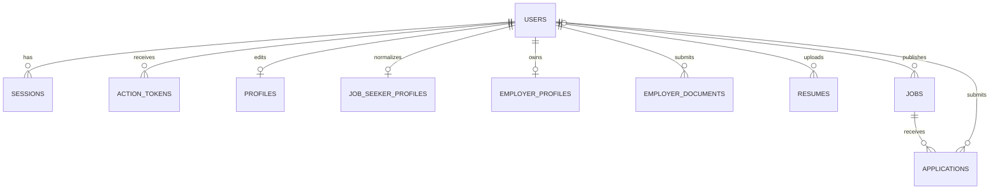

# Database reference

[Documentation index](README.md) · [API](API.md)

## Engines and migration source

`server/database.mjs` selects MySQL by default and supports SQLite with `DB_CONNECTION=sqlite`. MySQL uses `mysql2/promise`, InnoDB and utf8mb4; SQLite uses Node's built-in `DatabaseSync`, foreign keys, WAL and a busy timeout. SQL parameters and an adapter normalize the small set of dialect differences used by the application.

Migrations are JavaScript definitions in that module, with initial schemas in `server/schema-mysql.mjs` and `server/schema-sqlite.mjs`. There is **no** `server/migrations/` directory. Application timestamps are Unix milliseconds. JSON values use MySQL JSON and serialized SQLite TEXT. The MySQL adapter returns JSON as strings; routes parse fields as needed.

| Exact migration              | Change                                                                               |
| ---------------------------- | ------------------------------------------------------------------------------------ |
| `001_auth_and_profiles`      | Initial users, sessions, action_tokens, basic profiles and mail_queue                |
| `002_role_flow_and_matching` | `users.role_selected`, normalized Job Seeker profiles and jobs                       |
| `003_private_resumes`        | Resume ownership, file metadata and extraction analysis                              |
| `004_employer_workflow`      | Company/contact profiles and verification documents                                  |
| `005_job_lifecycle`          | Job vacancies, deadline, normalized job text and updated timestamp                   |
| `006_email_service`          | HTML email column support in mail_queue                                              |
| `007_applications`           | Applications, unique applicant/job pair, component scores and matched/missing skills |

`schema_migrations(version, applied_at)` records application. Startup checks `007_applications`; `db:status` reports that latest marker, not a full per-migration list. New installations may already include HTML in the base mail schema; migration 006 tolerates the existing column.

```powershell
npm run db:create
npm run db:migrate
npm run db:status
```

Migrations are additive and rerunnable; no rollback CLI or data export/import between engines is implemented. Back up a real database and private files before operational upgrades. Tests use disposable databases; never point experiments at production data.

## Entity dictionary

| Entity                | Key fields                                                                                                                                                                                                                                     | Meaning                                                                                                |
| --------------------- | ---------------------------------------------------------------------------------------------------------------------------------------------------------------------------------------------------------------------------------------------- | ------------------------------------------------------------------------------------------------------ |
| `users`               | `id`, unique `email`, `full_name`, nullable `password_hash`, unique nullable `google_id`, `profile_photo`, `auth_provider`, `email_verified`, `role`, `role_selected`, `profile_completion`, `account_status`, consent fields, created/updated | Identity and role; passwords are Argon2id hashes                                                       |
| `sessions`            | `token_hash`, nullable `user_id`, `csrf`, `expires_at`                                                                                                                                                                                         | Opaque server-side sessions; anonymous sessions support pre-login CSRF                                 |
| `action_tokens`       | `token_hash`, `user_id`, `purpose`, `expires_at`                                                                                                                                                                                               | Single-use verify/reset token hashes                                                                   |
| `profiles`            | PK/FK `user_id`, province, municipality, education, comma-separated skills, preferred_job, work_setup, step                                                                                                                                    | Basic editable onboarding data                                                                         |
| `job_seeker_profiles` | PK/FK `user_id`, JSON `data`, `normalized_profile_text`, nullable `resume_text`, onboarding_step, completed, updated_at                                                                                                                        | Matching input. `resume_text` exists but current analysis flow does not populate raw resume text here. |
| `employer_profiles`   | PK/FK `user_id`, company_name, industry, description, address, province, municipality, company_size, contact_person/position, business_email, contact_number, website, verification_status/reason, verified_at/by, updated_at                  | Company profile and current review decision                                                            |
| `employer_documents`  | `id`, `user_id`, document_type, storage_path, original_filename, file_size, uploaded_at                                                                                                                                                        | Private employer file metadata; current type value is generic `verification`                           |
| `jobs`                | `id`, nullable employer_id, title, company_name, description, industry, location, employment_type, work_setup, salary_min/max, required/preferred_skills, education_required, experience_required, status, created_at                          | Vacancy data; migration 005 adds vacancies, application_deadline, normalized_job_text, updated_at      |
| `resumes`             | `id`, user_id, storage_path, original_filename, file_size, parsing_status, JSON analysis, uploaded_at, parsed_at                                                                                                                               | Private files and original extraction suggestions                                                      |
| `applications`        | `id`, job_id, job_seeker_id, status, match_score, five component scores, matched_skills, missing_skills, applied_at, updated_at                                                                                                                | Application-time match evidence and current application state                                          |
| `mail_queue`          | `id`, recipient, subject, body, html, created_at, attempts                                                                                                                                                                                     | Pending delivery. Bodies may contain verification/reset links; treat as sensitive.                     |
| `schema_migrations`   | version, applied_at                                                                                                                                                                                                                            | Migration markers                                                                                      |

`verified_by` is stored as an Admin ID but does not have a declared foreign key. `mail_queue` is not FK-linked to users because employer contact recipients may differ from login accounts. SQLite `employer_documents.user_id` is ownership-scoped by code but lacks the MySQL foreign-key declaration; do not assume identical cascade guarantees for this table.

## Logical ER diagram



This is a logical relationship diagram; the dictionary notes physical FK exceptions. Most identity-owned data cascades on user deletion. Application references use `ON DELETE RESTRICT`; job closure updates status rather than deleting rows. No public delete-user/job endpoint is currently exposed.

## Status values and invariants

- Roles: `job_seeker`, `employer`, `admin`; public registration cannot create Admins.
- Employer review: default/submitted `pending`, API decisions `verified`/`rejected`; UI recognizes `suspended`, but no suspension API exists.
- Jobs: workflow `draft` → `active` → `closed`; creation may directly activate only for verified employers. The original jobs schema defaults status to active, so business APIs explicitly set draft/active.
- Resume: current flow stores `processing`, then `completed` or `failed`; `pending` is a conceptual state, not currently written by the upload handler.
- Applications: `submitted`, `under_review`, `shortlisted`, `rejected`, `withdrawn`. UI labels are Applied, Under Review, Shortlisted, Not Selected and Withdrawn.
- Unique `(job_id, job_seeker_id)` prevents duplicate applications, including reapplication after withdrawal.
- Employer transitions accept only source `submitted`/`under_review`; withdrawal accepts submitted/under_review/shortlisted. No interview/offer/hired states are exposed by the API.

Status strings mostly use TEXT/VARCHAR rather than database enum constraints; API validation is authoritative. There is no `application_status_history` or notification-record table.

## Match snapshot semantics

Applications persist integer overall percent and semantic/skills/location/education/experience numeric components plus matched/missing skill arrays. SQLite uses REAL and MySQL uses DECIMAL(7,5) for components. The engine identifier is returned when scoring but **not stored** in the application table.

Employer Highest Match sorts stored `match_score`; it does not rerun embeddings against edited profiles. Name, education, skills and accepted experience shown alongside the snapshot are current profile data. Resume access selects the applicant's latest resume, because applications have no `resume_id` or immutable profile snapshot column. These distinctions matter when explaining historical evidence.

## Career data and retention

Ten occupations and ten practice guides are code-defined in `server/career.mjs`, not database tables. Career suggestions, skills-gap priorities and learning recommendations are recalculated for the Job Seeker and not added to employer scoring records.

The mail worker purges expired sessions/tokens and queue messages older than 24 hours. There is no scheduled resume/employer-document retention process. Local document files must be backed up with the database; a metadata-only database backup cannot restore a private PDF.
